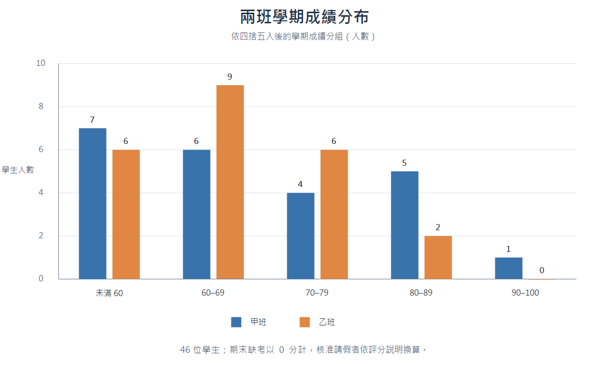

Codex 專案路徑：`C:/Users/wchen/OneDrive/Desktop/成績分析小報告/-`

# 學習分析概論成績分析報告

資料來源：[grades.csv](grades.csv)；計分規則：[評分說明.md](評分說明.md)。成績表登錄日期為 2026-06-24 至 2026-06-29。

## 答案卡

| 項目 | 結果 |
|---|---|
| 甲班、乙班人數 | 甲班 23 人；乙班 23 人 |
| 期末考全班平均 | 60.9 分（44 人計分） |
| 學期成績及格率 | 全班 33/46，71.7%；甲班 16/23，69.6%；乙班 17/23，73.9% |
| 學期成績不及格、建議老師關心 | 13 人；名單見下表，僅列學號末三碼 |
| 兩班學期成績分布 | 見下圖 |

### 未及格學生

| 班級 | 學號末三碼 | 學期成績 |
|---|---:|---:|
| 甲班 | 607 | 52 |
| 甲班 | 627 | 52 |
| 甲班 | 646 | 52 |
| 甲班 | 617 | 55 |
| 甲班 | 620 | 55 |
| 甲班 | 622 | 55 |
| 甲班 | 608 | 57 |
| 乙班 | 625 | 48 |
| 乙班 | 639 | 52 |
| 乙班 | 628 | 53 |
| 乙班 | 642 | 53 |
| 乙班 | 602 | 56 |
| 乙班 | 616 | 59 |

### 兩班學期成績分布

| 學期成績 | 甲班 | 乙班 | 合計 |
|---|---:|---:|---:|
| 未滿 60 | 7 | 6 | 13 |
| 60–69 | 6 | 9 | 15 |
| 70–79 | 4 | 6 | 10 |
| 80–89 | 5 | 2 | 7 |
| 90–100 | 1 | 0 | 1 |
| **合計** | **23** | **23** | **46** |

## 計算方式與資料處理

學期成績按作業平均 30%、小考平均 20%、期中考 20%、期末考 30% 加權後四捨五入至整數；60 分（含）以上及格。全班平均學期成績為 67.6 分，中位數為 68 分，範圍為 48 至 96 分。甲班平均 68.7 分，乙班平均 66.6 分；兩班平均相差 2.1 分，但乙班及格率較高。

期末考平均依評分說明計算：41 位到考學生使用原始分數，3 位缺考學生以 0 分計，2 位核准請假者不列入，因此分母為 44 人。期末考平均為 60.9 分。核准請假的學生在學期成績計算中，依其餘 70% 評量項目換算為百分制。

原始資料有 49 筆資料列，依學號去重後為 46 人。學號末三碼 610、626、644 各有兩筆紀錄，依規定採用登錄時間較晚、備註為補交的紀錄。這是處理重複列與補交資料的方式。

資料包含姓名及完整學號，但本報告不列姓名或完整學號；需要辨識個案時只列學號末三碼。CSV 只有各項總分，沒有題目層級成績，無法據此判斷個別學生的錯誤題目或特定單元弱點。

## VERIFY.md 檢查結果

| 檢查項目 | 結果 |
|---|---|
| 依評分說明計分 | 重新依權重、缺考 0 分、核准請假按 70% 換算及整數四捨五入計算 46 位學生；及格 33 人，平均 67.6 分。 |
| 答案卡項目 | 已列兩班人數、期末考全班平均、全班及兩班及格率、13 位未及格學生末三碼，並附兩班成績分布圖。 |
| 班級與成績分布 | 甲、乙班各 23 人；及格人數分別為 16、17 人；各成績區間人數合計 46 人，與原始資料重算一致。 |
| 期末考平均 | 44 位計分者的平均為 60.9091 分，四捨五入至小數第一位為 60.9 分；41 位到考、3 位缺考按 0 分計，2 位核准請假者排除。 |
| 分布圖與名單 | 圖表各區間人數與附表一致；未及格名單共 13 人，均以學號末三碼呈現。 |
| 個資 | 報告未包含學生姓名或完整學號。 |

以上檢查項目均符合 `VERIFY.md` 與 `評分說明.md` 的要求，核對未發現不一致。
